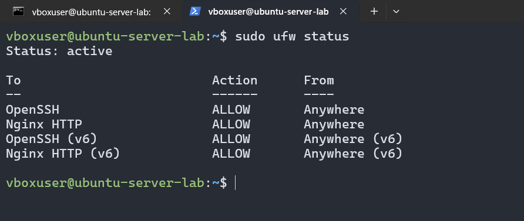
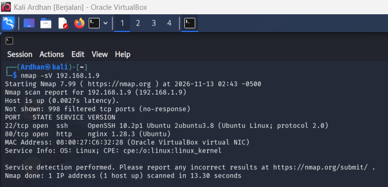
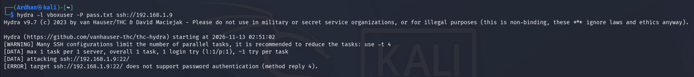

# Proyek 01: Linux Server Hardening, Validasi Serangan & Analisis Log Forensik

## 1. Ringkasan Proyek (Overview)
Proyek ini mendokumentasikan proses pembangunan, pengamanan (*hardening*), pengujian kerentanan, serta investigasi log insiden pada infrastruktur **Ubuntu Server** di dalam lingkungan laboratorium virtual (*Home Lab*). Tujuan utama proyek ini adalah menerapkan prinsip pertahanan berlapis (*Defense-in-Depth*) menggunakan *firewall* berbasis jaringan dan autentikasi kriptografi, kemudian memvalidasi efektivitasnya terhadap simulasi serangan siber dari sisi eksternal.

---

## 2. Arsitektur & Topologi Lab
Seluruh simulasi dijalankan secara lokal menggunakan **Oracle VirtualBox** dengan konfigurasi jaringan *Bridged Adapter* agar setiap mesin memiliki alamat IP independen dalam satu segmen jaringan lokal (`192.168.1.0/24`):

| Peran Perangkat | Sistem Operasi | Alamat IP | Fungsi dalam Simulasi |
| :--- | :--- | :--- | :--- |
| **Target Server** | Ubuntu Server LTS | `192.168.1.9` | Peladen *web* (Nginx) yang diamankan dan dipantau. |
| **Workstation Admin** | Windows 11 (Host) | `192.168.1.5` | Perangkat administrator sah untuk akses jarak jauh via SSH. |
| **Attacker Machine** | Kali Linux | `192.168.1.10` | Mesin penguji keamanan untuk pemindaian port dan simulasi serangan. |

---

## 3. Tahap 1: Implementasi Pertahanan (Blue Team - Server Hardening)

### A. Manajemen Pembaruan & Hak Akses Pengguna (Least Privilege)
* Melakukan pembaruan paket keamanan sistem operasi (*Patch Management*) menggunakan `sudo apt update && sudo apt upgrade -y` untuk menutup celah kerentanan versi lama.
* Menerapkan pemisahan hak akses dengan membuat akun khusus staf (`staff_it`) dan membatasi penggunaan akun `root` secara langsung.

### B. Konfigurasi Firewall Jaringan (UFW)
Mengaktifkan *Uncomplicated Firewall* (UFW) dengan kebijakan bawaan **Default Deny Incoming** (memblokir seluruh lalu lintas masuk secara otomatis) dan hanya membuka pintu layanan yang dibutuhkan:
* **Port 22/TCP (OpenSSH):** Untuk administrasi server jarak jauh secara terenkripsi.
* **Port 80/TCP (Nginx HTTP):** Untuk memublikasikan layanan *web server*.


*(Catatan: Unggah screenshot status `ufw status` dan tampilan "Welcome to nginx!" di browser Anda dengan nama file `01-ufw-nginx.png`)*

### C. Pengamanan Akses SSH (SSH Key Authentication)
Untuk menghilangkan risiko peretasan tebakan kata sandi (*Brute Force*), metode autentikasi berbasis *password* dinonaktifkan dan diganti sepenuhnya menggunakan pasangan kunci kriptografi **ED25519**:
1. Membuat pasangan kunci privat dan publik di *Workstation Admin* (`ssh-keygen -t ed25519`).
2. Menanamkan kunci publik ke dalam direktori `~/.ssh/authorized_keys` milik server target.
3. Menonaktifkan login *password* pada `/etc/ssh/sshd_config` dengan mengubah parameter menjadi `PasswordAuthentication no` dan me-restart layanan `ssh`.

---

## 4. Tahap 2: Pengujian Keamanan (Red Team - Penetration Testing)

### A. Pemindaian Layanan & Port (Reconnaissance)
Dari mesin **Kali Linux (`192.168.1.10`)**, dilakukan pemindaian jaringan menggunakan **Nmap** untuk melihat permukaan serangan (*attack surface*) yang terekspos:

```bash
nmap -sV 192.168.1.9
```

**Temuan Utama:**
* Sebanyak **998 port TCP berstatus `filtered` (no-response)**, membuktikan bahwa *firewall* UFW berhasil menyaring dan menjatuhkan paket pemindaian secara diam-diam.
* Hanya **Port 22 (OpenSSH)** dan **Port 80 (Nginx)** yang terdeteksi dalam status `open`.


*(Catatan: Unggah screenshot hasil perintah `nmap -sV` dari Kali Linux dengan nama file `02-nmap-scan.png`)*

### B. Simulasi Serangan Brute Force SSH
Setelah mendeteksi Port 22 terbuka, dilakukan pengujian serangan tebakan kata sandi otomatis menggunakan **Hydra** terhadap akun `vboxuser`:

```bash
hydra -l vboxuser -P pass.txt ssh://192.168.1.9
```

**Hasil Validasi:**
Serangan langsung ditolak pada detik pertama dengan pesan `[ERROR] target ssh://192.168.1.9:22/ does not support password authentication`. Ini membuktikan bahwa menonaktifkan autentikasi *password* sepenuhnya mematahkan serangan *Brute Force* pada layanan SSH.


*(Catatan: Unggah screenshot hasil perintah Hydra yang gagal dari Kali Linux dengan nama file `03-hydra-blocked.png`)*

---

## 5. Tahap 3: Investigasi Log & Analisis Insiden (SOC / Blue Team)
Sebagai langkah deteksi insiden, dilakukan pemeriksaan catatan keamanan sistem pada file `/var/log/auth.log` di Ubuntu Server menggunakan perintah `sudo tail -n 25 /var/log/auth.log`:

```text
2026-11-13T07:35:57.462141+00:00 ubuntu-server-lab sshd-session[16399]: Accepted publickey for vboxuser from 192.168.1.5 port 57002 ssh2: ED25519 SHA256:LAlvEX8qwdnnSaRIoU8QTtsTeWxs6dPkJ+RwmymcXCM
2026-11-13T07:43:33.350197+00:00 ubuntu-server-lab sshd-session[16489]: Connection closed by 192.168.1.10 port 46186
2026-11-13T07:51:03.656235+00:00 ubuntu-server-lab sshd-session[16500]: Received disconnect from 192.168.1.10 port 47930:11: Bye Bye [preauth]
2026-11-13T07:51:03.658779+00:00 ubuntu-server-lab sshd-session[16500]: Disconnected from authenticating user vboxuser 192.168.1.10 port 47930 [preauth]
```

**Analisis Forensik Log:**
* **07:35:57 (Akses Sah):** Tercatat `Accepted publickey` dari IP `192.168.1.5` (*Workstation Admin*) menggunakan kunci kriptografi *ED25519*.
* **07:43:33 (Deteksi Pemindaian):** Koneksi dari IP `192.168.1.10` (*Kali Linux*) ditutup langsung (`Connection closed`) saat melakukan pemindaian Nmap.
* **07:51:03 (Deteksi Serangan):** Keterangan `Disconnected from authenticating user vboxuser 192.168.1.10 ... [preauth]` mengonfirmasi adanya upaya percobaan masuk ilegal dari IP `192.168.1.10` yang langsung diputus pada fase pra-autentikasi sebelum sempat mencoba kata sandi.

---

## 6. Kesimpulan & Pembelajaran (Key Takeaways)
* Kombinasi kebijakan **Default Deny** pada *firewall* (UFW) dan penggantian metode login ke **SSH Key Authentication** terbukti sangat efektif menutup permukaan serangan jaringan serta menggagalkan upaya *Brute Force*.
* Pemantauan berkala terhadap `/var/log/auth.log` memungkinkan tim keamanan membedakan antara lalu lintas administrator yang sah dan aktivitas pemindaian atau percobaan intrusi dari alamat IP mencurigakan.

